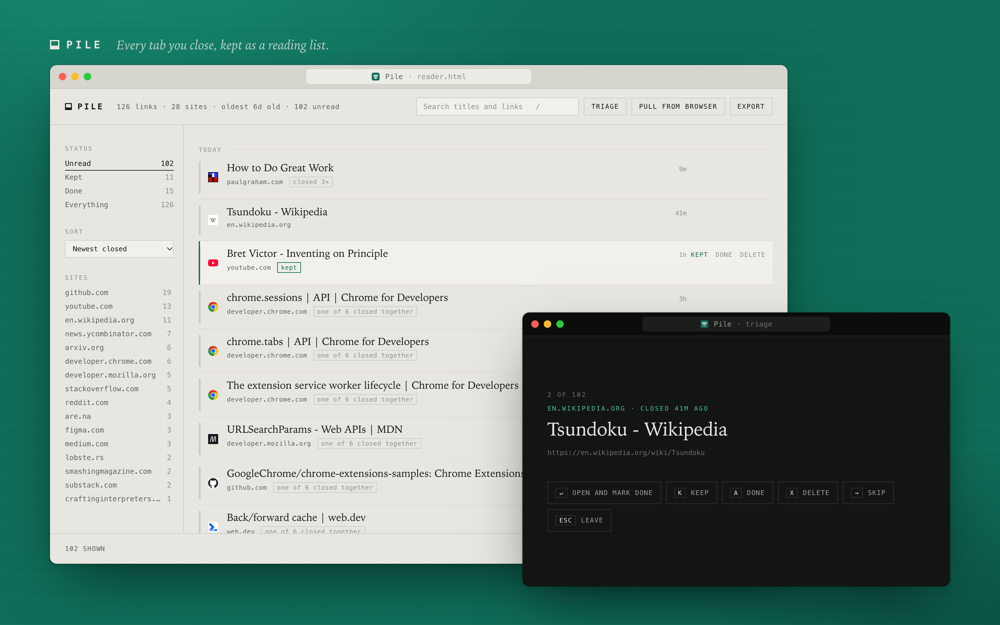

# Pile

Every tab you close gets kept as a reading list you can come back to.



Pile is a Chrome extension (Manifest V3). It records each tab as you close it and lays the lot out as a plain, searchable index: titles in a serif, everything else in small mono type. It has no host permissions, makes no network requests, and keeps everything on your machine.

## Install

Pile isn't on the Chrome Web Store, so load it unpacked.

1. Clone it somewhere permanent, like `~/Developer/pile`, not Downloads. Chrome loads it from disk every launch, so if the folder moves, the extension breaks.

   ```bash
   git clone https://github.com/NChandrasekharR/pile.git ~/Developer/pile
   ```

2. Go to `chrome://extensions` (or `arc://extensions`, `edge://extensions`, `brave://extensions`).
3. Turn on **Developer mode**, top right.
4. Click **Load unpacked** and pick the folder.
5. Pile opens a pinned tab and immediately pulls whatever your browser is holding in Recently Closed.

**Install it before you quit the browser.** Chrome's Recently Closed list only holds 25 entries and gets wiped on restart. An entry can be a whole closed window, and the API hands back every tab inside it, so those 25 entries can be hundreds of links. After a restart they're gone for good.

From then on Pile records every tab as you close it, so the 25-entry ceiling stops mattering.

## Using it

Toolbar icon or `Alt+Shift+P` opens the pile. The badge counts unread.

**Keyboard**

| key | does |
|---|---|
| `/` | search |
| `j` `k` | move the cursor |
| `o` | open in a background tab, mark read |
| `s` | keep |
| `e` | mark done |
| `x` | delete |
| `u` | undo the last delete |
| `t` | triage mode |

**Triage mode** shows one link at a time, full screen: `↵` open, `K` keep, `A` done, `X` delete, `→` skip, `←` back, `Esc` leave. It runs over whatever's currently filtered, so filter to a single site first and burn through it.

**Export** gives you Markdown grouped by site, raw JSON, or a bookmarks file any browser can import.

## What it stores

Everything lives in `chrome.storage.local` on this machine. Nothing is sent anywhere: the extension has no host permissions and makes no network requests. Favicons come from the browser's own cache.

Deleting the extension deletes the pile, so export first if you care.

| permission | why |
|---|---|
| `tabs` | read a tab's URL and title so it can be recorded when it closes |
| `sessions` | read Recently Closed on install and after a restart |
| `storage`, `unlimitedStorage` | keep the pile in `chrome.storage.local` |
| `favicon` | show site icons from the browser's cache |

## Notes

- URLs are de-duplicated and stripped of `utm_*`, `fbclid` and friends, so the same article closed four times is one row with a `closed 4×` chip.
- Tabs closed together in one burst are tagged as a group, so a window-close reads as a unit rather than 50 unrelated rows.
- The hairline down the left of each row darkens with age. Rows that have sat for twelve days are solid.
- `chrome://`, extension and `file://` pages are ignored.

## How it works

- `tabs.onRemoved` only hands you a tab id, and by then the tab's URL and title are gone. So the service worker keeps a live mirror of open tabs in `chrome.storage.session` and reads the closed tab's details back out of it.
- Quitting the browser closes tabs without firing `onRemoved`. On the next launch Pile sweeps the browser's Recently Closed list to pick up what the quit took.
- Every write goes through the service worker, one at a time, so a 50-tab window closing at once can't drop rows.

```
manifest.json    MV3 manifest
background.js    service worker: capture, batching, badge, Recently Closed import
lib/store.js     storage: URL cleaning, de-duplication, serialised writes
reader.html      the reading list page
reader.css
reader.js
icons/
```

There's no build step. Edit a file, then hit reload on Pile's card in `chrome://extensions`.

## License

[MIT](LICENSE)
